# Investigating a VPN account compromise

This is my write-up for a blue-team analyst challenge, "The Tunnel Is Up. Are
We Safe?". I was given a set of logs and captures from one night on a company
network, where someone logged into the VPN as an employee called Jordan Smith,
and I had to work out what actually happened and defend the call.

The point of the challenge is not to break into anything. It is to read the
evidence, build a timeline, and decide whether the session was **Legitimate**,
**Suspicious** or **Compromised**, and then say how sure I am and why. All of
the data here is simulated challenge material. My personal VPN key was never
part of the investigation and is deliberately left out of this repo.

## My verdict

**Compromised. Confidence: Medium.**

An unauthorised party got into a valid account over the VPN, then used it to
reach data the real employee never touches and moved a large amount of it out
of the network. I hold confidence at medium, not high, because the evidence
cannot tell me whether this was an outside attacker or the employee staging a
fake compromise. I'll come back to that honestly at the end.

## What's in here

1. What normal looked like, and why this night broke it
2. How they got in (password guessing, then MFA fatigue)
3. What they did once inside (recon, finance, data theft)
4. What device it was
5. The timeline, in one place
6. What weakens my verdict, and what I still don't know
7. VPN, ZTNA or Hybrid, and what I'd do next
8. The files

## 1. What normal looked like (E06)

You can't call a night unusual until you know what a normal one looks like. The
baseline for this user:

- Works UK office hours, roughly 08:00 to 18:30 local
- Connects from the United Kingdom, on his managed laptop `DEV-JS-441`
- Normally moves 20 to 90 MB in a session
- Uses `git.internal` a lot, `files.internal` sometimes
- **Never** touched `finance.internal` in the previous 30 days

Keep that last point in mind. He's a software developer. Finance isn't his job.

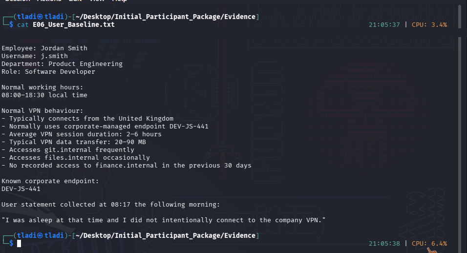

## 2. How they got in (E03 and E04)

The authentication log shows four failed passwords in a row from the same
address, then a success on the fifth. That is not someone mistyping their own
password. That's guessing.

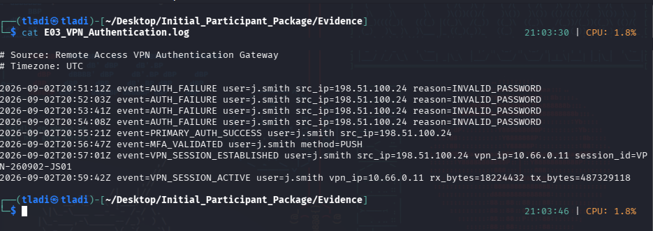

Same log with the failures and the success pulled out with `grep`:

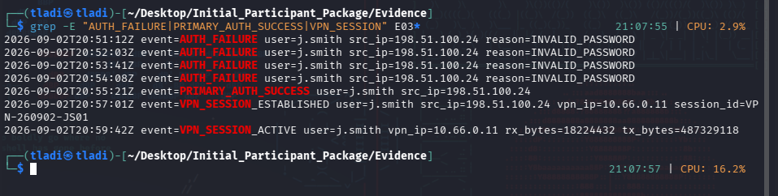

Then the multi-factor log. A push goes to Jordan's phone, and it is ignored
four times, then approved on the fifth. That pattern, prompts ignored and then
suddenly approved, is **MFA fatigue**: an attacker who already has the password
spams the approval until the victim taps it to make it stop, or does it half
asleep. The user later said he *was* asleep.

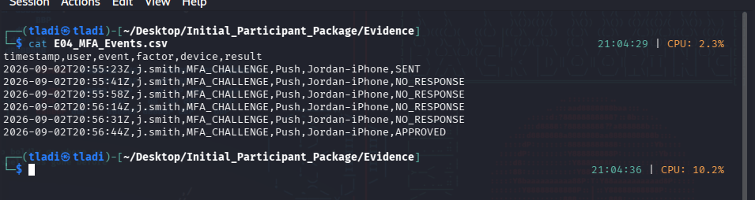

So both the password and the second factor were beaten, and both in the way an
attacker beats them, not the way an owner uses them.

## 3. What they did inside (E05)

Straight after connecting, the session looks up three servers by name, git,
files, and finance, which is someone getting their bearings. Then it opens
finance (never in the baseline) and pulls a large read off an SMB share.

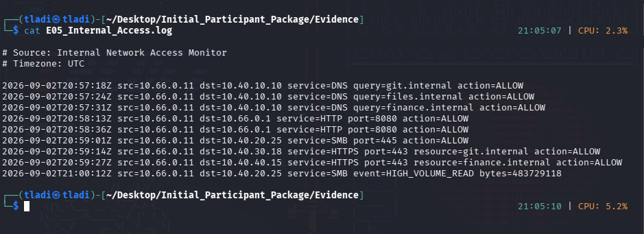

The finance access and the bulk read, isolated:

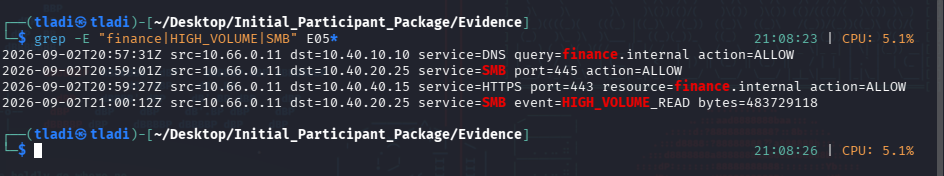

The numbers are the part that matters. About **483 MB** was read from the file
share, and the VPN session log (E03) shows about **487 MB** sent out of the
tunnel. Those two matching is the signature of data being stolen, not someone
browsing.

## 4. What device it was (E07)

The connecting device fingerprint was `UNKNOWN-7C91`, never seen for this user,
and it failed the compliance check. Meanwhile the real corporate laptop
`DEV-JS-441` went quiet: its security agent last checked in at 19:48 and not
again until 04:46 the next morning. The whole incident happened inside that
gap. So it wasn't his managed machine.

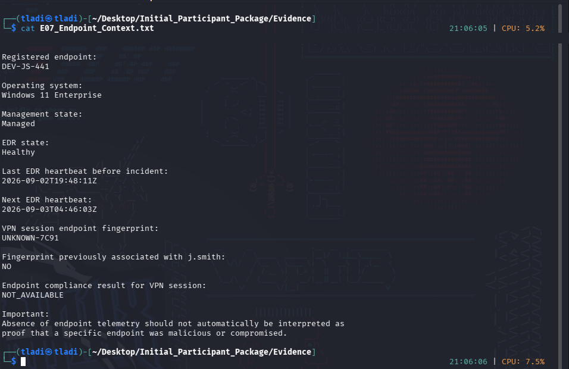

The evidence file itself warns that missing device telemetry isn't proof of an
attack on its own, and that's fair. It's one brick, not the whole wall.

## 5. The timeline (UTC)

The logs are in UTC, so I kept everything in UTC. The whole active phase is
about nine minutes.

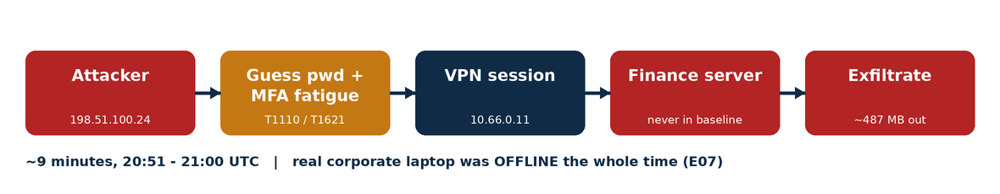

```
19:48   real laptop DEV-JS-441 goes offline (stays dark all night)
20:51   four failed passwords begin, from 198.51.100.24
20:55   password accepted on the 5th try
20:55   four MFA pushes ignored...
20:56   ...then approved
20:57   VPN session up (10.66.0.11); DNS lookups: git, files, finance
20:59   finance.internal accessed; ~487 MB going out
21:00   SMB HIGH_VOLUME_READ ~483 MB
04:46   real laptop finally checks back in
```

The outer capture (E01) is the encrypted tunnel seen from the internet side: I
can see the WireGuard session between the attacker IP and the VPN server, but
not the contents.

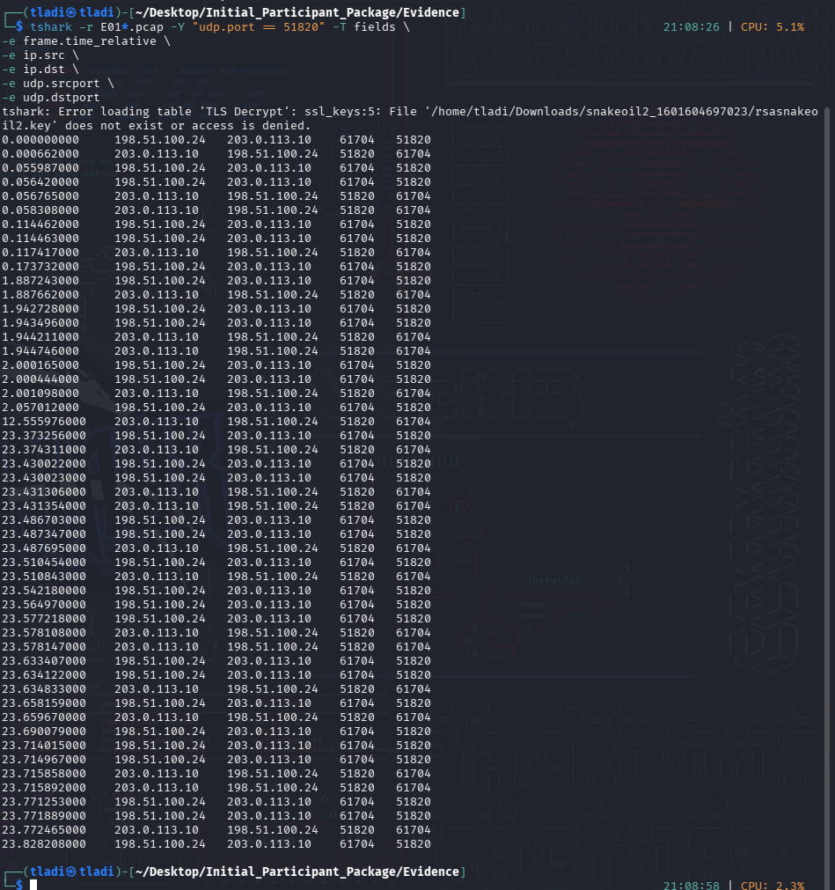

The decrypted inner capture (E02) also shows the internal web access was made
with `curl`, a command-line tool, not a browser, which fits scripted access
rather than a person clicking around. I treat that as a supporting detail, since
developers use curl too.

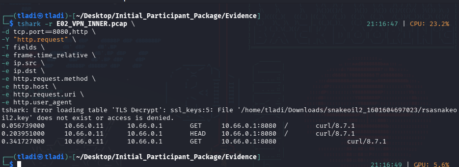

## 6. What weakens it, and what I don't know

I don't want to only show the evidence that agrees with me.

- The MFA prompt *was* approved. Fatigue explains it, but it's still an approval.
- `curl` is dual-use. On its own it proves nothing.
- Missing endpoint data is not proof by itself.
- I can't geolocate the attacker's IP, and I can't tell who owns the unknown
  device. Those are the two facts that aren't in the evidence.

Because of that last gap, I can't fully rule out an **insider false-flag**: the
employee himself using another device, ignoring his own prompts to fake a
fatigue attack, and denying it the next day. Nothing in the evidence points to
that specifically, so I don't lead with it, but I can't kill it either. That's
why my confidence is medium, and it's what I'd chase next: geolocation of the
IP, ownership of the device, where the data went, and forensics on the laptop's
telemetry gap.

## 7. VPN, ZTNA or Hybrid

My recommendation is **Hybrid**: Zero Trust as the default, with a traditional
VPN kept only as a controlled exception.

This incident is the classic VPN weakness. A VPN checks you once at the door and
then trusts you inside the network, and that flat trust is exactly how a
developer's session reached finance. Zero Trust flips that to "never trust,
always verify": every request is checked per resource, not once at login, and
the session context (odd hour, unknown device, denied prompts) would have got
this one refused.

I'd keep a locked-down VPN only for the cases Zero Trust handles badly, legacy
non-web services and emergency break-glass access.

**Immediate response:** kill the session, disable the account, block the source
IP, quarantine the device, reset the password and re-enrol MFA, isolate the
finance host and the share.

**Longer term:** phishing-resistant MFA with number matching (this kills the
fatigue attack outright), device posture checks, least privilege so a developer
can't reach finance, and detections for the exact pattern here, failures then a
success, a burst of denied prompts then an approval, off-hours logins, and large
outbound transfers.

## 8. The files

- `deliverables/` — my written analysis (verdict, timeline, evidence analysis,
  architecture decision, and response).
- `evidence/` — the challenge evidence (E01–E07), with only the programme name
  removed from the header lines. Verify the repo copies with
  `sha256sum -c SHA256SUMS.txt`:

  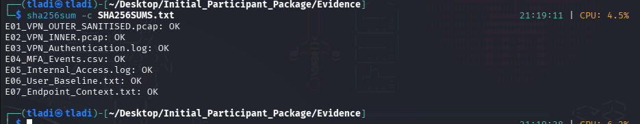
- `images/` — terminal screenshots of the evidence and the attack-flow diagram
  used above.

---

*Simulated data from a training challenge. Everything here is my own analysis;
the incident and the "Jordan Smith" account are fictional.*
